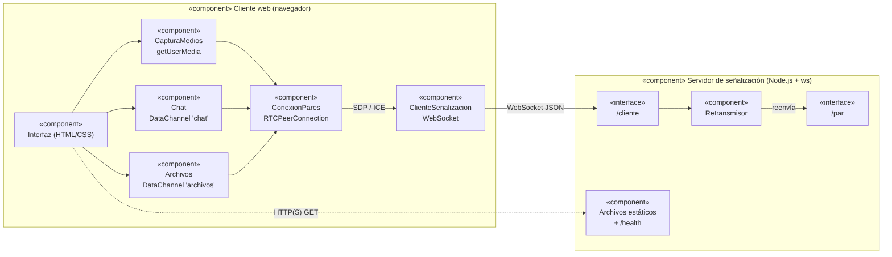
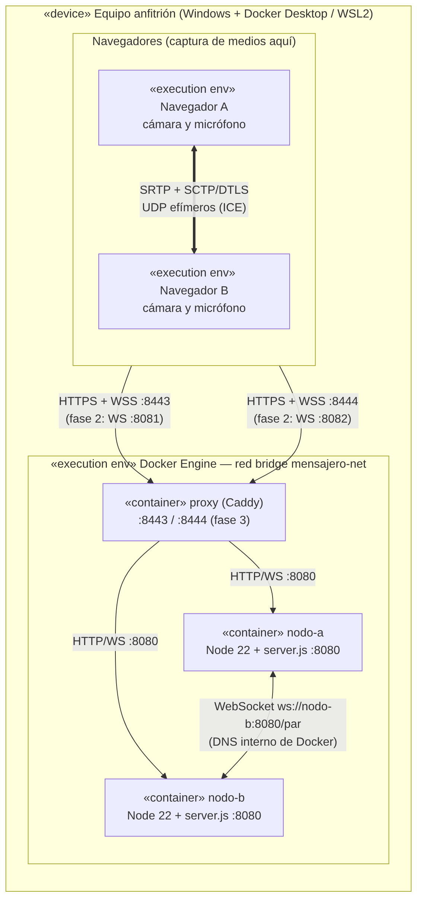
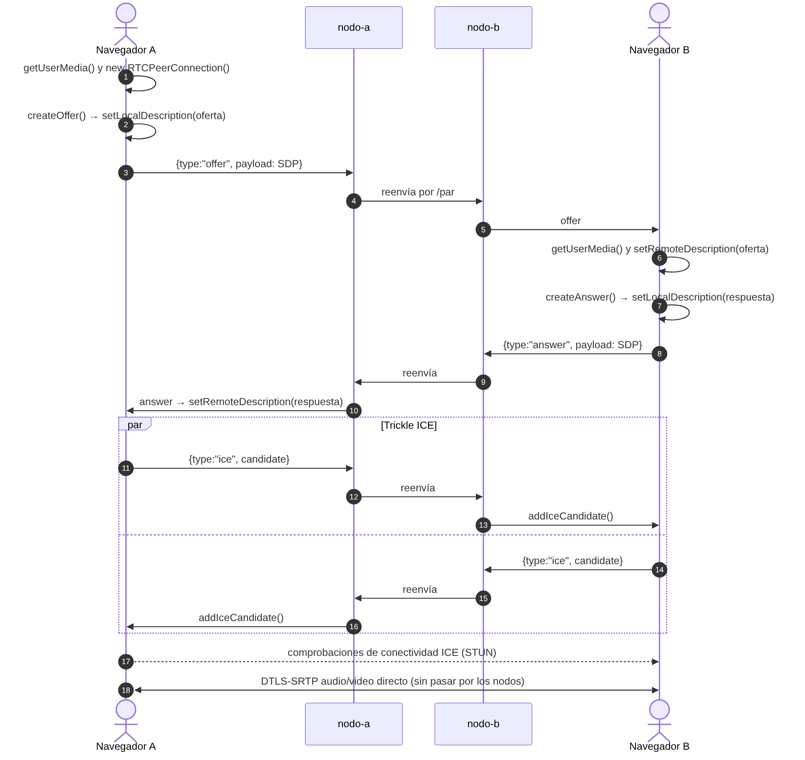
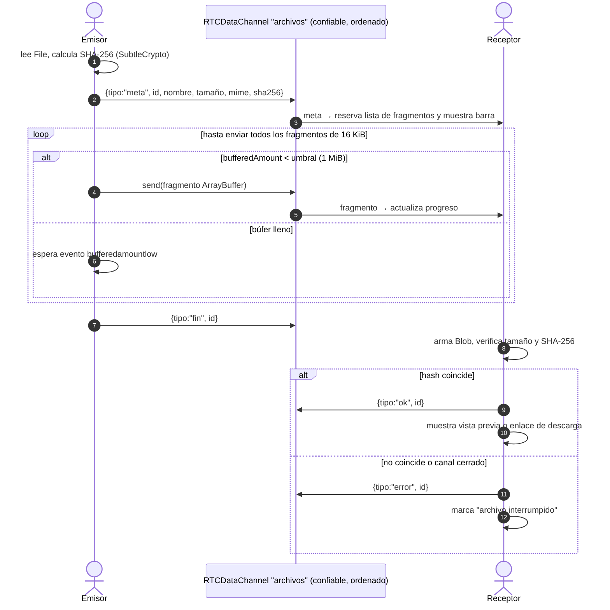
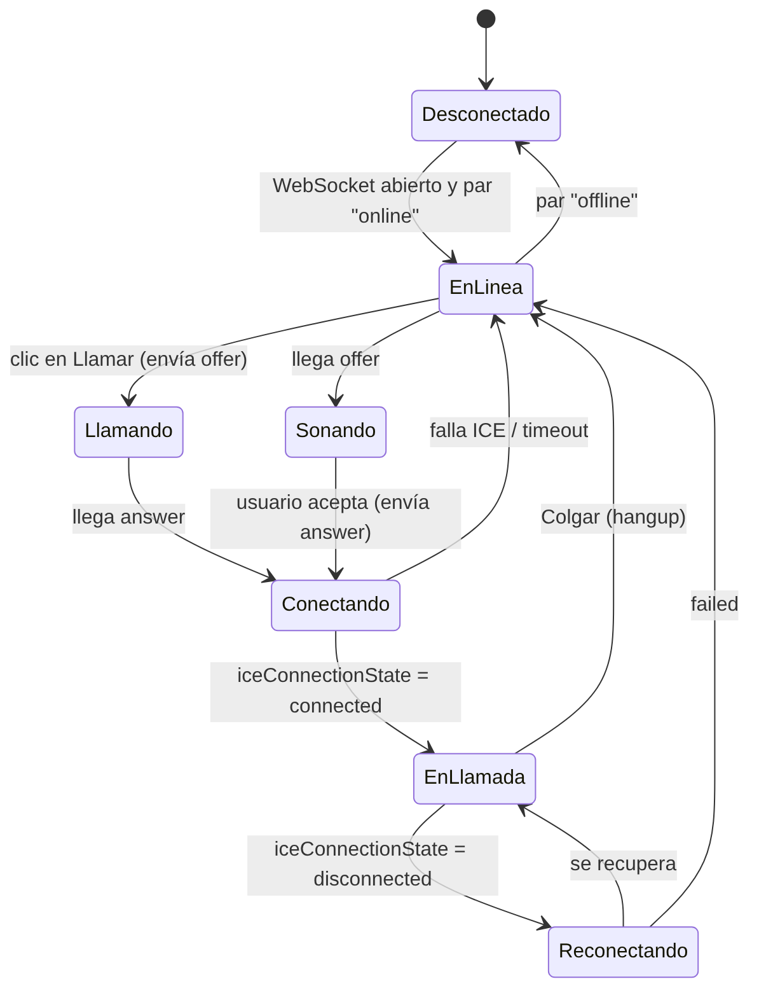

<div class="portada">

**UNIVERSIDAD TECNOLÓGICA DE PEREIRA**<br/>Facultad de Ingenierías · Ingeniería de Sistemas y Computación<br/>Sistemas Distribuidos

# Informe de investigación
## Mensajero WebRTC en contenedores Docker

**Estudiante:** Tomás Marín Ariza · **Código:** 1031541121<br/>**Docente:** Felipe Gutiérrez Isaza · **Fecha:** 22 de noviembre de 2026

</div>

## Introducción

Este informe documenta la investigación previa a la construcción de un mensajero web con chat, videollamada y envío de archivos entre dos nodos. Responde a los bloques A a G de la guía. Las afirmaciones técnicas citan su fuente entre corchetes; la lista completa está al final. La plataforma elegida es **Docker**: dos contenedores (`nodo-a` y `nodo-b`) en una red bridge definida por el usuario, cada uno con un servidor de señalización en Node.js. Los navegadores se comunican entre sí directamente por WebRTC.

## Bloque A. Contenedores, máquinas virtuales y redes

### A.1 Virtualización completa frente a contenedores

Una **máquina virtual** emula un equipo completo: un hipervisor reparte el hardware y cada VM arranca su propio sistema operativo con su propio kernel. Un **contenedor** es un proceso aislado que comparte el kernel del anfitrión; el aislamiento lo dan los *namespaces* (vista propia de procesos, red y sistema de archivos) y los *cgroups* (límites de CPU y memoria) [1][7].

| Criterio | Máquina virtual | Contenedor |
|---|---|---|
| Aislamiento | Fuerte: kernel propio, frontera de hardware virtual | Menor: kernel compartido; un fallo del kernel afecta a todos [7] |
| Recursos | GB de RAM y disco por SO invitado | MB; solo la aplicación y sus librerías |
| Arranque | Decenas de segundos a minutos (arranca un SO) | Fracciones de segundo a pocos segundos (arranca un proceso) |
| Portabilidad | Imagen de disco grande, atada al hipervisor | Imagen por capas, portable a cualquier Docker Engine |

Felter et al. midieron que los contenedores igualan o superan a las VM en casi todas las cargas, con sobrecosto casi nulo en CPU y memoria [8].

### A.2 Plataforma elegida

Se eligió **Docker**. Se gana: arranque de los dos nodos con un solo comando (`docker compose up`), descubrimiento por nombre sin configurar DNS, poco consumo para correr dos nodos en un portátil y despliegue reproducible en un archivo versionado. Se pierde: aislamiento más débil que el de una VM y, sobre todo, el contenedor **no tiene acceso directo a la cámara ni al micrófono** del anfitrión. Esto no es un problema en esta arquitectura, porque la captura la hace el navegador del anfitrión (ver D.2).

### A.3 Comunicación y descubrimiento por nombre

Dos nodos en la misma red virtual se comunican por IP como dos equipos en una LAN: cada uno recibe una dirección en la subred de la red virtual y el tráfico pasa por un switch virtual (en Linux, un *bridge*) [2]. Para no depender de IP, que cambian en cada arranque, se usa un **servidor DNS**: en Docker, cada red definida por el usuario tiene un DNS interno que resuelve el nombre del servicio o contenedor a su IP actual [3].

### A.4 (Docker) Imagen, contenedor y Dockerfile

Una **imagen** es una plantilla de solo lectura formada por capas; un **contenedor** es una instancia en ejecución de esa imagen, con una capa escribible encima [1]. Instrucciones del Dockerfile del proyecto [4]:

| Instrucción | Qué hace |
|---|---|
| `FROM node:22-alpine` | Imagen base: Node.js 22 sobre Alpine Linux (liviana) |
| `WORKDIR /app` | Directorio de trabajo de las instrucciones siguientes |
| `COPY package*.json ./` | Copia solo el manifiesto, para reutilizar la capa de dependencias en caché |
| `RUN npm install --omit=dev` | Ejecuta un comando al construir y guarda el resultado como capa |
| `COPY server.js ./` | Copia el código fuente |
| `EXPOSE 8080` | Documenta el puerto que escucha la aplicación |
| `USER node` | Ejecuta el proceso sin privilegios de root |
| `CMD ["node","server.js"]` | Comando por defecto al iniciar el contenedor |

### A.5 (Docker) Tipos de red

| Driver | Comportamiento | ¿Sirve aquí? |
|---|---|---|
| `bridge` | Red privada en un solo anfitrión; NAT hacia afuera | **Sí** (definida por el usuario) |
| `host` | El contenedor usa la pila de red del anfitrión, sin aislamiento | No: choque de puertos entre los dos nodos |
| `overlay` | Red entre varios anfitriones (Swarm) | No: ambos nodos están en un solo equipo |
| `none` | Sin red | No |

Se usa una **bridge definida por el usuario** (`mensajero-net`) y no la `bridge` por defecto, porque solo la primera ofrece resolución automática por nombre entre contenedores y un aislamiento propio [3].

### A.6 (Docker) Descubrimiento por nombre

En una red definida por el usuario, el demonio de Docker atiende un DNS embebido (127.0.0.11 dentro de cada contenedor). Cuando `nodo-a` abre `ws://nodo-b:8080/par`, el DNS devuelve la IP vigente de `nodo-b` [2][3]. Por eso el código no contiene ninguna IP: la URL del par llega por la variable de entorno `PEER_URL`.

### A.7 (Docker) Exponer frente a publicar un puerto

**Exponer** (`EXPOSE` en el Dockerfile) solo documenta en qué puerto escucha el contenedor; no abre nada hacia el anfitrión. **Publicar** (`-p 8081:8080` o `ports:` en Compose) crea una regla que reenvía un puerto del anfitrión al del contenedor [6]. Entre contenedores de la misma red no hace falta publicar: `nodo-a` llega a `nodo-b:8080` directamente.

### A.8 (Docker) Docker Compose

Compose describe una aplicación de varios contenedores en un archivo YAML y la levanta con `docker compose up` [5]. En `services` se declara cada nodo (`build`, `environment` para variables, `ports`, `networks`); en `networks`, la red `mensajero-net` con `driver: bridge`; en `volumes`, el almacenamiento persistente (en este avance no se requiere). Así, el despliegue de dos nodos es reproducible y queda versionado en Git.

## Bloque B. Comunicación en tiempo real

**B.1 ¿Qué es WebRTC?** Es un conjunto de APIs del navegador y protocolos de red para enviar audio, video y datos arbitrarios **entre pares**, con baja latencia y sin plugins [9][10]. Resuelve la comunicación interactiva en tiempo real atravesando NAT y con cifrado obligatorio (DTLS-SRTP). Lo especifican dos organismos: el **W3C** define la API JavaScript (`RTCPeerConnection`, `RTCDataChannel`) [9] y el **IETF**, en el grupo de trabajo *rtcweb*, define los protocolos [10].

**B.2 Por qué hace falta señalización.** Antes de hablarse, los pares no saben uno del otro: ni su dirección, ni qué códecs soportan, ni las claves de cifrado. WebRTC deliberadamente **no define** el canal de señalización; cada aplicación usa el que quiera [11]. Por él viajan tres cosas: (1) la descripción de sesión SDP (oferta y respuesta), (2) los candidatos ICE (direcciones posibles) y (3) mensajes de control de la aplicación (llamar, colgar, presencia). El audio y el video **no** pasan por el servidor.

**B.3 SDP y el modelo oferta/respuesta.** SDP (*Session Description Protocol*) es un formato de texto que describe una sesión multimedia: medios, códecs, direcciones, huella del certificado DTLS [12]. El modelo oferta/respuesta [13] y su uso en WebRTC (JSEP) [11] funcionan así:

1. A crea `RTCPeerConnection`, agrega sus pistas de cámara y micrófono y llama `createOffer()`.
2. A aplica `setLocalDescription(oferta)` y la envía a B por la señalización.
3. B aplica `setRemoteDescription(oferta)`, agrega sus pistas, llama `createAnswer()` y `setLocalDescription(respuesta)`.
4. B envía la respuesta; A aplica `setRemoteDescription(respuesta)`.
5. En paralelo, cada lado emite candidatos ICE (`onicecandidate`) que el otro agrega con `addIceCandidate()` (*trickle ICE*).
6. ICE elige un par de candidatos que funcione, se hace el *handshake* DTLS y empiezan a fluir los medios por SRTP (Figura 4).

**B.4 ICE, STUN y TURN.** **ICE** [14] reúne candidatos (dirección local *host*, dirección pública *server-reflexive* obtenida por STUN y dirección de *relay* obtenida por TURN), los prueba en pares y elige el mejor que funcione. **STUN** [15] permite que un equipo descubra su IP y puerto públicos tal como los ve un servidor externo. **TURN** [16] es un servidor que retransmite el tráfico cuando no hay ruta directa posible.

| Escenario | Necesita |
|---|---|
| Dos navegadores en el mismo equipo o LAN (este laboratorio) | Solo candidatos *host*; ni STUN ni TURN |
| Equipos en redes distintas con NAT "cono" | STUN |
| NAT simétrico, CGNAT o firewall que bloquea UDP | TURN (retransmite todo el tráfico) |

**B.5 NAT.** La traducción de direcciones permite que muchos equipos con IP privadas (por ejemplo 192.168.x.x) compartan una IP pública. El NAT solo crea una entrada en su tabla cuando el tráfico **sale**, así que un paquete que llega sin una entrada previa se descarta: nadie de afuera puede iniciar la conexión [17]. Si ambos pares están detrás de NAT, ninguno puede alcanzar al otro directamente; ICE con STUN abre "agujeros" enviando tráfico saliente simultáneo, y cuando el NAT asigna un puerto distinto por destino (NAT simétrico) la única salida es TURN [14][17].

## Bloque C. Canal de señalización

**C.1 WebSocket.** Es un protocolo que, tras un *handshake* HTTP con `Upgrade: websocket`, deja abierta una conexión TCP **full-dúplex y persistente** por la que cliente y servidor envían mensajes en cualquier momento [18]. Con HTTP y peticiones periódicas (*polling*), el cliente pregunta cada cierto tiempo: aumenta la latencia (hasta un período completo), se repiten las cabeceras en cada petición y el servidor no puede enviar nada por iniciativa propia. Para señalización, donde los candidatos ICE llegan en ráfagas y el tiempo importa, WebSocket es la opción natural.

**C.2 Alternativas.**

| Opción | Dirección | Ventajas | Desventajas |
|---|---|---|---|
| **WebSocket (`ws`)** — elegido | Bidireccional | Estándar [18], API nativa en navegadores, librería mínima | Reconexión y salas se implementan a mano |
| Socket.IO [19] | Bidireccional | Reconexión automática, salas, acuses | Protocolo propio: un cliente WebSocket puro (wscat) no lo habla; más dependencias |
| SSE [20] | Solo servidor → cliente | Simple, sobre HTTP | El cliente necesita otro canal (POST) para enviar la oferta |
| MQTT [21] | Pub/sub vía broker | Muy liviano, QoS | Requiere un broker adicional (Mosquitto) y WebSocket en el navegador de todos modos |

Se descartó Socket.IO porque la guía pide probar desde consola con herramientas genéricas (`wscat`) y porque las salas solo se necesitarían en el RETO.

**C.3 Formato de los mensajes.** JSON sobre WebSocket, con un sobre común:

```json
{ "id": "uuid", "type": "chat|offer|answer|ice|hangup|presence",
  "from": "ana", "to": null, "origin": "nodo-a",
  "payload": { ... }, "ts": 1763850000000 }
```

`payload` es `{text}` en `chat`, `{sdp}` en `offer`/`answer`, `{candidate, sdpMid, sdpMLineIndex}` en `ice` y `{peer:"online|offline"}` en `presence`. El servidor agrega `id`, `origin` y `ts`, valida `type` y **reenvía sin interpretar** el contenido; responde al emisor con `{type:"ack", delivered}`. El campo `to` permite señalización dirigida en el futuro.

## Bloque D. Medios: audio y video

**D.1 Acceso a cámara y micrófono.** El navegador expone `navigator.mediaDevices.getUserMedia({audio, video})`, que devuelve un `MediaStream` tras pedir permiso al usuario [22]. La API solo existe en un **contexto seguro**: páginas servidas por HTTPS o desde `http://localhost` / `127.0.0.1`, que se consideran confiables [23]. Si el usuario niega el permiso, la promesa se rechaza con `NotAllowedError`; si no hay dispositivo, con `NotFoundError`. Ambos casos deben mostrarse en la interfaz.

**D.2 Cámara y contenedores.** Un contenedor es un proceso aislado sin acceso a los dispositivos del anfitrión salvo que se le pasen explícitamente (`--device`); en Windows con Docker Desktop corre además dentro de una VM de WSL2, donde la cámara USB del anfitrión no está disponible [1]. Pero en esta arquitectura el contenedor **no necesita la cámara**: la captura ocurre en el **navegador del anfitrión**, que descarga la interfaz desde el nodo y envía los medios directo al otro navegador. El nodo solo sirve archivos estáticos y señalización. Como se accede por `localhost:8081`, el navegador lo trata como contexto seguro; para entrar desde otro equipo se agregará un proxy HTTPS (Caddy) en la fase 3.

**D.3 Códecs.** Un códec (codificador-decodificador) comprime la señal de audio o video para transmitirla y la reconstruye al recibirla. WebRTC obliga a todo navegador a soportar **Opus y G.711** en audio [24] y **VP8 y H.264** (perfil *Constrained Baseline*) en video [25]; los navegadores modernos negocian además VP9 y AV1 [27][28].

| Códec | Compresión | CPU | Compatibilidad | Licencia |
|---|---|---|---|---|
| Opus (audio) | Muy alta, 6–510 kbps, adaptable a voz y música [26] | Baja | Obligatorio en todos | Libre (BSD) |
| VP8 | Base | Baja | Obligatorio en todos | Libre (Google, BSD) |
| H.264 | Similar a VP8 | Baja, con aceleración por hardware muy extendida | Obligatorio; preferido en Safari/iOS | Patentes (MPEG LA); Cisco paga la licencia de OpenH264 |
| VP9 | ~30–40 % mejor que VP8 | Media | Chrome, Firefox, Edge; Safari reciente | Libre |
| AV1 | La mejor (~30 % más que VP9) | Alta en software; poco hardware | Chrome, Edge, Firefox; parcial | Libre (AOMedia) |

El artículo de MirrorFly [27] presenta una comparación similar, pero es el blog de un proveedor comercial; se contrastó con la RFC 7742 [25] y la documentación de MDN [28]. Para el proyecto se dejará la negociación por defecto: **VP8 u H.264 + Opus**, que garantizan compatibilidad entre cualquier par de navegadores.

**D.4 Ancho de banda.** Las tasas en WebRTC son adaptativas (el estimador de ancho de banda baja resolución o *bitrate* si la red no da) [29]. Rangos de referencia de proveedores: **480p ≈ 0,4–2 Mbps** y **720p ≈ 1,4–6 Mbps** por flujo, según movimiento y códec [29][30]. Una videollamada típica a 720p con poco movimiento se sostiene con ~1,5 Mbps por sentido; el audio Opus agrega solo ~32–64 kbps. En una sola máquina o LAN esto no es una limitación.

## Bloque E. Transferencia de archivos y texto

**E.1 RTCDataChannel.** Es un canal bidireccional de datos arbitrarios entre pares, sobre la misma `RTCPeerConnection`, que viaja en **SCTP encapsulado en DTLS** sobre UDP [31][32]. Puede configurarse como **confiable y ordenado** (por defecto: retransmite lo perdido y entrega en orden, como TCP) o **no confiable** (`ordered:false`, `maxRetransmits` o `maxPacketLifeTime`: descarta lo que llega tarde, útil para juegos o telemetría). El proyecto usará dos canales confiables: `chat` y `archivos`.

**E.2 Fragmentación y control del búfer.** Los mensajes de un DataChannel tienen un tamaño máximo práctico (≈ 16 KiB es el valor interoperable seguro entre navegadores; la SDP anuncia `max-message-size`) [31][33]. Un archivo de 20 MB se corta en fragmentos (`File.slice()` → `ArrayBuffer` de 16 KiB). Si se llama `send()` en un ciclo sin control, los datos se acumulan en memoria y el canal puede cerrarse. Se usa **control de flujo**: antes de enviar se revisa `bufferedAmount`; si supera un umbral (1 MiB) se espera el evento `bufferedamountlow`, configurado con `bufferedAmountLowThreshold` [33].

**E.3 Alternativa por HTTP.** El emisor sube el archivo con `POST` al nodo y el receptor lo descarga con `GET`.

| | DataChannel (elegido) | HTTP a través del servidor |
|---|---|---|
| Ruta | Directa entre pares, cifrada extremo a extremo (DTLS) | Pasa y se almacena en el servidor |
| Carga del servidor | Ninguna | Disco y ancho de banda del nodo |
| Receptor desconectado | No se puede enviar | Puede descargarlo después |
| Complejidad | Fragmentación y búfer manuales | Simple; reanudación con `Range` |

Se elige DataChannel porque cumple el espíritu P2P del laboratorio y no requiere volúmenes en los contenedores.

**E.4 Integridad.** El emisor envía primero un mensaje `meta` con nombre, tamaño, tipo MIME y **hash SHA-256** calculado con `crypto.subtle.digest()` [34]. El receptor cuenta los bytes recibidos (progreso y completitud), arma un `Blob`, recalcula el SHA-256 y compara. Si coinciden, ofrece vista previa (``, `<audio>`, `<video>`) o descarga; si no, o si el canal se cierra antes del mensaje `fin`, marca el archivo como interrumpido (Figura 5).

## Bloque F. Interfaz y servidor

**F.1 Servidor: Node.js 22 + `ws`.** Node.js usa un modelo de E/S asíncrono y orientado a eventos, adecuado para muchas conexiones WebSocket con poca CPU [35]; `ws` es una implementación de WebSocket (RFC 6455) mínima, rápida y sin dependencias [36]. Además, cliente y servidor comparten lenguaje (JavaScript) y JSON nativo. **Alternativa descartada:** Python con `websockets`/`aiohttp`: es igual de válido, pero obliga a cambiar de lenguaje entre cliente y servidor.

**F.2 Interfaz: HTML + JavaScript puro.** Las APIs que se usan (`getUserMedia`, `RTCPeerConnection`, `WebSocket`) son nativas del navegador. Una sola página con un módulo JS por componente (señalización, medios, pares, chat, archivos) se sirve como archivos estáticos desde el mismo nodo, sin paso de compilación. **Alternativa descartada:** React o Vue: agregan herramientas de construcción y una capa de estado innecesaria para una sola pantalla.

**F.3 Bosquejo de la interfaz.**

<div class="wire">
<div class="wtop">● Conectado como <b>ana</b> · nodo-a &nbsp;&nbsp;|&nbsp;&nbsp; Otro extremo: <span class="ok">● en línea</span></div>
<div class="wbody">
<div class="wvid"><div class="remote">Video remoto</div><div class="local">Video local</div>
<div class="btns">[ 📞 Llamar ] [ ✖ Colgar ] [ 🎤 Silenciar ] [ 📷 Cámara ]</div></div>
<div class="wchat"><b>Chat</b><br/>ana: hola<br/>luis: ¡hola!<br/>📎 foto.jpg (2,1 MB) ✔ [ver]<br/>📎 video.mp4 ███████░░ 72 %<div class="win">[ Escribe un mensaje… ] [Enviar] [📎 Archivo]</div></div>
</div>
</div>

*Figura 1. Bosquejo de la interfaz: video, controles de llamada, chat, archivos con progreso e indicador de presencia.*

## Bloque G. Arquitectura propuesta

### G.1 Diagrama de componentes



*Figura 2. Componentes. El cliente web se divide en módulos que dependen de `ConexionPares`; el servidor ofrece dos interfaces WebSocket (`/cliente`, `/par`) y el retransmisor las une.*

### G.2 Diagrama de despliegue



*Figura 3. Despliegue. Fase 2: puertos 8081/8082 publicados, WebSocket sin TLS. Fase 3: proxy Caddy con HTTPS/WSS. El enlace entre navegadores es UDP directo negociado por ICE.*

### G.3 Diagramas de funcionamiento



*Figura 4. Secuencia del inicio de una videollamada: oferta, respuesta y candidatos ICE pasan por los dos nodos; los medios no.*



*Figura 5. Envío de un archivo por fragmentos con control de búfer y verificación SHA-256.*



*Figura 6. Estados de la conexión desde el punto de vista de un usuario.*

### G.4 Tecnologías elegidas

| Componente | Elegida | Alternativa descartada | Motivo |
|---|---|---|---|
| Plataforma de nodos | Docker + Compose | Máquinas virtuales (VirtualBox + Vagrant) | Arranque en segundos, DNS por nombre sin configurar, menos RAM |
| Red | Bridge definida por el usuario | Bridge por defecto / host | DNS interno; aislamiento; sin choque de puertos |
| Imagen base | `node:22-alpine` | `node:22` (Debian) | ~5 veces más pequeña |
| Servidor | Node.js 22 + `ws` | Python + `websockets` | Mismo lenguaje que el cliente; E/S asíncrona |
| Señalización | WebSocket + JSON | Socket.IO, SSE, MQTT | Estándar; probable con `wscat`; bidireccional |
| Medios | WebRTC (`RTCPeerConnection`) | Retransmitir por el servidor | P2P, baja latencia, cifrado obligatorio |
| Códecs | Negociación por defecto (VP8/H.264 + Opus) | Forzar AV1 | Compatibilidad total, menos CPU |
| Archivos | RTCDataChannel confiable, 16 KiB | Subida HTTP al nodo | Directo, cifrado, sin almacenamiento |
| Interfaz | HTML + JS puro | React | APIs nativas; sin compilación |
| HTTPS (fase 3) | Caddy (`tls internal`) | nginx + mkcert | Certificado local automático, config. de 5 líneas |
| UML | Mermaid (fuente en `docs/uml/`) | StarUML | Texto versionable en Git |

### G.5 Riesgos y mitigación

| Riesgo | Mitigación |
|---|---|
| Un nodo arranca antes que el otro y la conexión falla | Reconexión automática cada 2 s y cola de mensajes pendientes (ya implementado) |
| `getUserMedia` bloqueado al entrar por una IP que no es `localhost` | Usar `localhost:8081/8082` en el mismo equipo; proxy HTTPS (Caddy) para otros equipos |
| Pruebas en un solo equipo: una sola cámara para dos navegadores | Usar dos navegadores distintos (Chrome y Firefox) o el *flag* de cámara falsa de Chrome para pruebas |
| ICE falla entre redes distintas (NAT simétrico) | STUN público para pruebas; contenedor `coturn` como TURN si se necesita |
| Archivo de 20 MB satura el DataChannel o la memoria | Fragmentos de 16 KiB y control con `bufferedAmountLowThreshold` |
| Archivo corrupto o interrumpido | Hash SHA-256 y conteo de bytes; mensaje de error visible |
| El otro extremo se desconecta en plena llamada | Mensajes `presence` y eventos `iceconnectionstatechange` → aviso en la interfaz |
| Contenedor no se detiene con `docker compose down` | Manejo de SIGTERM que cierra los sockets (ya implementado) |

## Referencias

<div class="refs">


1. Docker Inc. *What is Docker?* (Docker overview). https://docs.docker.com/get-started/docker-overview/
2. Docker Inc. *Networking overview*. https://docs.docker.com/engine/network/
3. Docker Inc. *Bridge network driver*. https://docs.docker.com/engine/network/drivers/bridge/
4. Docker Inc. *Dockerfile reference*. https://docs.docker.com/reference/dockerfile/
5. Docker Inc. *Compose file reference*. https://docs.docker.com/reference/compose-file/
6. Docker Inc. *Port publishing and mapping*. https://docs.docker.com/engine/network/port-publishing/
7. M. Souppaya, J. Morello, K. Scarfone. *Application Container Security Guide*, NIST SP 800-190, 2017. https://doi.org/10.6028/NIST.SP.800-190
8. W. Felter, A. Ferreira, R. Rajamony, J. Rubio. "An updated performance comparison of virtual machines and Linux containers", IEEE ISPASS, 2015. https://doi.org/10.1109/ISPASS.2015.7095802
9. W3C. *WebRTC: Real-Time Communication in Browsers* (Recomendación). https://www.w3.org/TR/webrtc/
10. H. Alvestrand. *Overview: Real-Time Protocols for Browser-Based Applications*, RFC 8825, IETF, 2021.
11. J. Uberti, C. Jennings, E. Rescorla. *JavaScript Session Establishment Protocol (JSEP)*, RFC 9429, IETF, 2024.
12. A. Begen et al. *SDP: Session Description Protocol*, RFC 8866, IETF, 2021.
13. J. Rosenberg, H. Schulzrinne. *An Offer/Answer Model with SDP*, RFC 3264, IETF, 2002.
14. A. Keranen, C. Holmberg, J. Rosenberg. *Interactive Connectivity Establishment (ICE)*, RFC 8445, IETF, 2018.
15. M. Petit-Huguenin et al. *Session Traversal Utilities for NAT (STUN)*, RFC 8489, IETF, 2020.
16. T. Reddy et al. *Traversal Using Relays around NAT (TURN)*, RFC 8656, IETF, 2020.
17. F. Audet, C. Jennings. *NAT Behavioral Requirements for Unicast UDP*, RFC 4787, IETF, 2007.
18. I. Fette, A. Melnikov. *The WebSocket Protocol*, RFC 6455, IETF, 2011.
19. Socket.IO. *Documentation v4*. https://socket.io/docs/v4/
20. WHATWG. *HTML Living Standard — Server-sent events*. https://html.spec.whatwg.org/multipage/server-sent-events.html
21. OASIS. *MQTT Version 5.0*, 2019. https://docs.oasis-open.org/mqtt/mqtt/v5.0/mqtt-v5.0.html
22. W3C. *Media Capture and Streams*. https://www.w3.org/TR/mediacapture-streams/
23. W3C. *Secure Contexts*. https://www.w3.org/TR/secure-contexts/
24. JM. Valin, C. Bran. *WebRTC Audio Codec and Processing Requirements*, RFC 7874, IETF, 2016.
25. A.B. Roach. *WebRTC Video Processing and Codec Requirements*, RFC 7742, IETF, 2016.
26. JM. Valin, K. Vos, T. Terriberry. *Definition of the Opus Audio Codec*, RFC 6716, IETF, 2012.
27. MirrorFly. *Video codecs* (blog de proveedor comercial). https://www.mirrorfly.com/blog/video-codecs/
28. MDN Web Docs. *Codecs used by WebRTC*. https://developer.mozilla.org/en-US/docs/Web/Media/Guides/Formats/WebRTC_codecs
29. Amazon. *Chime SDK JS — Quality, bandwidth and connectivity*. https://aws.github.io/amazon-chime-sdk-js/modules/qualitybandwidth_connectivity.html
30. Cloudflare. *Realtime — Video resolution and simulcast*. https://developers.cloudflare.com/realtime/realtimekit/best-practices/video-and-simulcast/
31. R. Jesup, S. Loreto, M. Tüxen. *WebRTC Data Channels*, RFC 8831, IETF, 2021.
32. M. Tüxen et al. *Datagram Transport Layer Security (DTLS) Encapsulation of SCTP Packets*, RFC 8261, IETF, 2017.
33. MDN Web Docs. *RTCDataChannel: bufferedAmountLowThreshold*. https://developer.mozilla.org/en-US/docs/Web/API/RTCDataChannel/bufferedAmountLowThreshold
34. W3C. *Web Cryptography API* (`SubtleCrypto.digest`). https://www.w3.org/TR/WebCryptoAPI/
35. OpenJS Foundation. *Node.js v22 documentation*. https://nodejs.org/docs/latest-v22.x/api/
36. websockets/ws. *ws: a Node.js WebSocket library*. https://github.com/websockets/ws

</div>
